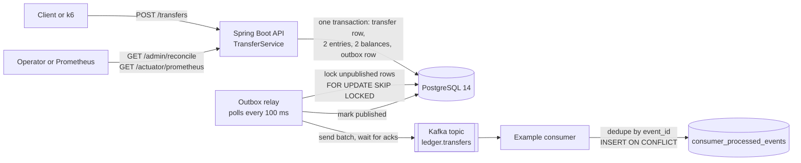

# ledger-service

[](https://github.com/byteKumar/ledger-service/actions/workflows/ci.yml)

A double-entry ledger service in Java 21 and Spring Boot: every transfer moves money between two accounts in one Postgres transaction, the books always balance, and a retried request never moves money twice.

Java 21 · Spring Boot 3.5 · PostgreSQL 14 · Flyway · Kafka 4.4 · Micrometer/Prometheus · JUnit 5 · Testcontainers · k6 · GitHub Actions

## Results at a glance

All numbers are measured, not estimated. Details, raw data and caveats are in [RESULTS.md](RESULTS.md).

- **Correctness under concurrency:** 10 runs × 200,000 transfers, 32 threads, 100 accounts, ~5% duplicate requests: **0 invariant violations, 0 duplicate money movements**.
- **Latency:** p99 under 50 ms up to **750 req/s** (26.77 ms) with k6 at a fixed arrival rate; 1000 req/s measured 51.07 ms. 0% errors at every tested rate.
- **Locking under high contention** (10 accounts, 1000 req/s): pessimistic p99 **8.17 ms**, 0 errors; optimistic p99 **120.65 ms**, 0.128% gave up.
- **Outbox with the relay killed mid-run:** 30,000 transfers committed, 30,000 events published, 30,000 consumed, 0 lost.
- **Found a Postgres 14.17 internal error** under optimistic contention (147 of 2,000,000 requests). A narrow retry brought failures to 0.

## Architecture



The relay runs inside the API process by default. With `ledger.outbox.relay.enabled=false` it runs as its own process, which is how the relay-kill test works.

How one transfer attempt runs (one database transaction, retried if it loses an optimistic race):

```
1. key already used?                  -> return the original (409 if the body differs)
2. read both accounts, lower id first   (FOR UPDATE in pessimistic mode)
3. INSERT transfer ON CONFLICT (idempotency_key) DO NOTHING
                                      -> a racing duplicate waits here, then replays
4. currency and funds checks          -> 422, everything rolls back
5. UPDATE accounts ... WHERE version = ?  (lower id first; 0 rows -> roll back, retry)
6. INSERT 2 entries (-amount, +amount)
7. INSERT outbox event
```

| Module | What it does |
|---|---|
| `account/` | Accounts, deposits, entry history with cursor pagination. `AccountRepository` holds the SQL, including the versioned `UPDATE` and `SELECT … FOR UPDATE`. |
| `transfer/` | `TransferService`: idempotency, retry loop with jittered backoff, optimistic or pessimistic mode, latency and retry metrics. `PostgresTransientErrors` recognises the one retried Postgres bug. |
| `outbox/` | `OutboxRepository`, `OutboxRelay` (publishes to Kafka, marks rows published after the ack), `OutboxMetrics` (backlog and age gauges). |
| `consumer/` | `TransferEventConsumer`: example downstream consumer that dedupes by event id. |
| `admin/` | `ReconcileService` and `GET /admin/reconcile`. |
| `web/` | Error responses as RFC 9457 problem+json. |
| `db/migration/` | Flyway migrations V1–V3: accounts, entries, deposits, transfers, outbox. |
| `bench/` | k6 script, benchmark scripts and raw results. The concurrency harness is `src/test/.../bench/ConcurrencyBenchmark.java`. |

## Approach

| Decision | Why | Trade-off |
|---|---|---|
| Money as `BIGINT` cents, plus `CHECK (balance >= 0)` | No floating-point rounding; the database refuses an overdraft even if the code has a bug. | Clients must know each currency's minor unit. |
| Idempotency key claimed with `INSERT … ON CONFLICT` inside the transfer transaction, before the business checks | The unique index makes a racing duplicate wait and then replay the original, so money moves at most once per key. | A rejected request (422) rolls back the claim, so the key can be reused later. Storing errors under the key, as Stripe does, would be the alternative. |
| Optimistic locking (`version` column, up to 10 attempts, then `503` + `Retry-After`) or pessimistic `SELECT … FOR UPDATE`, set by `ledger.transfer.locking` | Both are measured side by side. Both lock or update the lower account id first, so transfers can't deadlock (removing that order deadlocked within seconds). | Optimistic holds no locks while reading but redoes work under contention; pessimistic makes requests wait in line on the row lock. |
| Transactional outbox, relayed to Kafka with `acks=all`; rows marked published only after the ack | An event exists if and only if its transfer committed, and Kafka downtime doesn't block transfers. | At-least-once delivery, so consumers must dedupe. Events arrive after a delay, the outbox table grows, and `SKIP LOCKED` gives up global ordering across relay instances. |
| Reconciliation as single SQL statements in one `REPEATABLE READ` transaction | Each check sees one snapshot even while transfers commit; balances and deposits are summed in the same statement. | It scans every entry; at large scale it would need to run incrementally. |
| Retry exactly one Postgres internal error (`XX000`, "new multixact has more than one updating member") | Optimistic rollbacks plus foreign-key KEY SHARE locks trigger an unfixed Postgres bug; the failed transaction has already rolled back, so retrying is safe. | Depends on matching the error text. Any other `XX000` error still fails immediately. |

Data access is plain SQL through Spring's `JdbcClient`, so every query and lock is visible in the code.

**How it was measured**

- **Machine:** MacBook Air M3 (Mac15,12), 8 cores, 16 GB RAM, macOS 26.6.2, fanless. App, PostgreSQL 14.17, Kafka 4.4.0 and k6 v2.4.0 all ran on this one laptop, with Java 21.0.13 and default settings. Docker was stopped during benchmarks.
- **Concurrency:** in-process calls to the transfer service against real Postgres, 10 runs per configuration, every run from empty tables. Correctness is counted from the database after each run.
- **Load:** k6 constant-arrival-rate, 60 s per step, a fresh app and empty tables per step, and a 10 s warm-up that isn't recorded.
- **Locking and outbox:** the same k6 setup, one run per configuration.

## Results

From [RESULTS.md](RESULTS.md), unchanged.

**Concurrency** (10 runs × 200,000 transfers, 32 threads, 100 accounts, optimistic mode)

| | before the Postgres-bug retry | final code (with the retry) |
|---|---|---|
| invariant violations | 0 | 0 |
| duplicate money movements | 0 | 0 |
| transfers without exactly one outbox event | 0 | 0 |
| duplicate requests replayed | 100,059 | 100,068 |
| version-conflict retries | 848,567 | 797,589 |
| idempotency-race retries | 18,362 | 16,839 |
| Postgres-bug retries | n/a | 143 |
| failed with Postgres internal error | 147 | 0 |
| gave up after 10 attempts (503) | 77 | 55 |

**Load** (k6, 1,000 accounts, optimistic, 60 s per rate)

| target req/s | transfers/s | p95 ms | p99 ms | errors |
|---|---|---|---|---|
| 250 | 250.0 | 8.33 | 20.14 | 0% |
| 500 | 499.7 | 9.67 | 35.76 | 0% |
| 750 | 748.8 | 2.05 | 26.77 | 0% |
| 1000 | 999.3 | 7.56 | 51.07 | 0% |
| 1500 | 1497.2 | 35.85 | 105.82 | 0% |
| 2000 | 1985.9 | 89.86 | 312.92 | 0% |
| 3000 | 2503.5 | 3941.02 | 6295.66 | 0% |
| 4000 | 3171.4 | 3721.60 | 4463.96 | 0% |

The highest tested rate with p99 under 50 ms is 750 req/s. At 3000 and 4000 req/s the service was saturated (2503.5 and 3171.4 transfers/s, latency in seconds).

**Optimistic vs pessimistic** (1000 req/s, 60 s, one run each)

| contention | mode | transfers/s | p99 ms | errors | retries |
|---|---|---|---|---|---|
| low (1,000 accounts) | optimistic | 999.8 | 36.49 | 0% | 77 |
| low (1,000 accounts) | pessimistic | 1000.0 | 22.09 | 0% | 0 |
| high (10 accounts) | optimistic | 988.9 | 120.65 | 0.128% | 5,878 + 1 Postgres-bug |
| high (10 accounts) | pessimistic | 999.5 | 8.17 | 0% | 0 |

**Outbox with the relay killed** (500 req/s, 60 s, relay `kill -9` at 20 s, restarted at 35 s)

| | count |
|---|---|
| transfers committed | 30,000 |
| events published | 30,000 |
| messages on the Kafka topic | 30,000 |
| events processed by the consumer | 30,000 |
| committed transfers never consumed | 0 |
| consumer dedupes | 0 |
| max backlog while the relay was down | 8,335 |
| API during the outage | 500 req/s, 0% errors, p99 31.11 ms |

## How to run

Prerequisites: Java 21, Maven 3.9, PostgreSQL 14+, Kafka 4 (KRaft). The tests need Docker (Docker Desktop or Colima) for Testcontainers. On macOS with Homebrew:

```bash
brew install openjdk@21 maven postgresql@14 kafka colima docker
brew services start postgresql@14
createdb ledger
brew services run kafka        # KRaft, localhost:9092; `brew services stop kafka` to stop
source scripts/env.sh          # pins Java 21 and points Testcontainers at Colima
```

Run the service (Flyway creates the schema on startup):

```bash
mvn -DskipTests package
java -jar target/ledger-service-0.1.0.jar
```

Try it:

```bash
curl -s -XPOST localhost:8080/accounts -H 'content-type: application/json' -d '{"owner":"alice","currency":"USD"}'
curl -s -XPOST localhost:8080/accounts -H 'content-type: application/json' -d '{"owner":"bob","currency":"USD"}'
curl -s -XPOST localhost:8080/accounts/1/deposits -H 'content-type: application/json' -d '{"amount":10000}'
curl -s -XPOST localhost:8080/transfers -H 'content-type: application/json' \
  -d '{"from":1,"to":2,"amount":2500,"currency":"USD","idempotencyKey":"order-42"}'
curl -s 'localhost:8080/accounts/2/entries?limit=20'
curl -s localhost:8080/admin/reconcile
curl -s localhost:8080/actuator/prometheus | grep '^ledger_'
```

API summary:

| Endpoint | Result |
|---|---|
| `POST /accounts`, `GET /accounts/{id}` | create an account, read its balance |
| `POST /accounts/{id}/deposits` | bring money in from outside |
| `GET /accounts/{id}/entries?limit=&before=` | entry history, newest first, cursor-paginated |
| `POST /transfers` | `201` new; `200` + `Idempotent-Replayed: true` for a repeat; `409` same key, different body; `422` insufficient funds or currency mismatch; `503` + `Retry-After` after 10 conflicting attempts |
| `GET /admin/reconcile` | `200` when the books balance, `500` when they don't |
| `GET /actuator/prometheus` | `ledger_transfer_latency_seconds`, `ledger_transfer_retries_total`, `ledger_outbox_pending`, `ledger_outbox_oldest_age_seconds`, `ledger_outbox_publish_delay_seconds`, `ledger_consumer_events_total` |

Configuration:

| Property (env var) | Default | Meaning |
|---|---|---|
| `DB_URL`, `DB_USER`, `DB_PASSWORD`, `DB_POOL_SIZE` | `jdbc:postgresql://localhost:5432/ledger`, `$USER`, empty, `20` | Postgres connection |
| `KAFKA_BOOTSTRAP_SERVERS` | `localhost:9092` | Kafka |
| `ledger.transfer.locking` (`LEDGER_TRANSFER_LOCKING`) | `optimistic` | `optimistic` or `pessimistic`; use one mode per database |
| `ledger.transfer.max-attempts` | `10` | attempts before a `503` |
| `ledger.outbox.relay.enabled` | `true` | `false` to run the relay as a separate process |
| `ledger.outbox.relay.poll-interval-ms`, `batch-size` | `100`, `500` | relay pacing |
| `ledger.consumer.enabled` | `true` | the example deduping consumer |

Benchmarks: `bench/run-concurrency.sh`, `bench/run-load.sh`, `bench/run-outbox-kill.sh`. The exact commands are at the end of [RESULTS.md](RESULTS.md).

## Tests and CI

```bash
colima start
mvn verify
```

- **45 tests**, run against real PostgreSQL 14 and Kafka 4.4 containers (Testcontainers). They cover the API, idempotency, both locking modes under 32-thread contention, the outbox and consumer dedupe, reconciliation, metrics, and the Postgres-bug retry classifier.
- **GitHub Actions** runs `mvn verify` on ubuntu-latest for every push to `main` and every pull request: [latest green run](https://github.com/byteKumar/ledger-service/actions/runs/43928661401).
- The benchmarks are tagged `bench`, are excluded from `mvn verify`, and were not run on CI.

## Limitations

- **Single runs.** Load, locking and outbox results are one run per configuration. Only the concurrency test was repeated (10 runs per set).
- **Run-to-run spread.** The same 1000 req/s optimistic setup measured p99 51.07 ms in the load ladder and 36.49 ms in the locking run, about 15 ms apart. The real p99 < 50 ms limit is somewhere around 750–1000 req/s.
- **750 req/s step added afterwards.** It was run after the main ladder, once 1000 came in just over 50 ms. 1000 was not rerun.
- **One shared laptop.** App, Postgres, Kafka and k6 competed for the same 8 cores. Concurrency throughput fell from run to run, likely heat throttling on the fanless machine, but that isn't confirmed.
- **Locking run order.** The four cells ran in a fixed order, which could favour the earlier ones on a warming laptop. Pessimistic had a lower p99 at high contention than at low contention; that is unexplained.
- **Dedupe path covered by a test only.** The relay-kill run needed 0 dedupes, because the kill landed between relay batches. Re-send and dedupe are covered by `OutboxTest.resentEventIsDeduplicatedByConsumer`, not by the benchmark.
- **Not built:** cleanup of published outbox rows, authentication on `/admin/*`, a per-account balance cap (a single amount is capped at $10B in cents), and incremental reconciliation.
- **Not tested:** two instances running different locking modes against one database. They can deadlock on a shared idempotency key, and Postgres would abort one.
- **The Postgres-bug retry matches error text.** If a future Postgres version changes the message, the retry stops applying and those requests fail as before.
